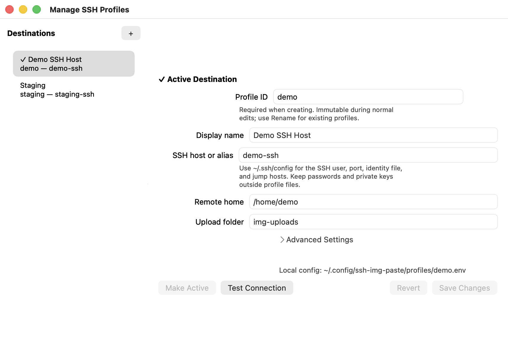
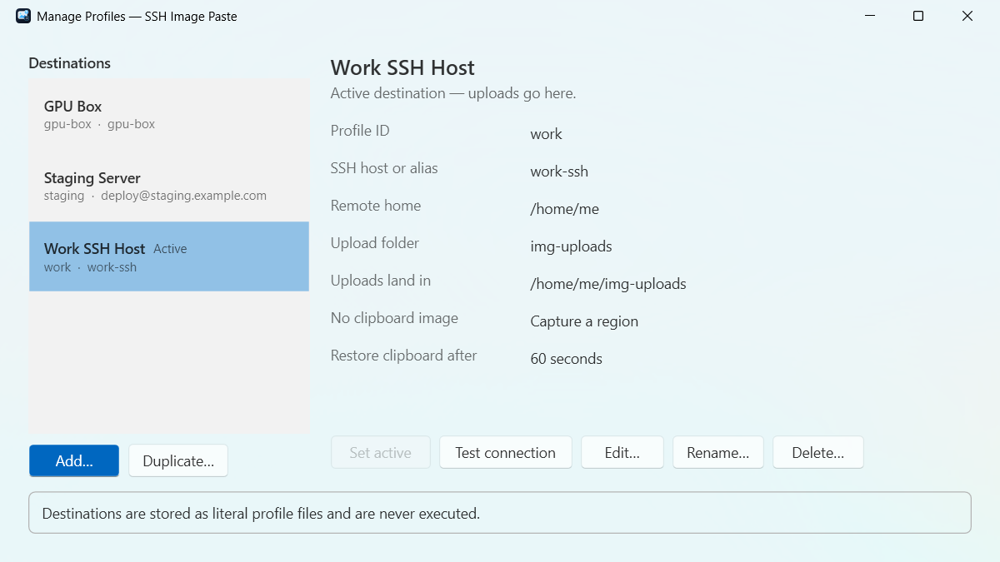
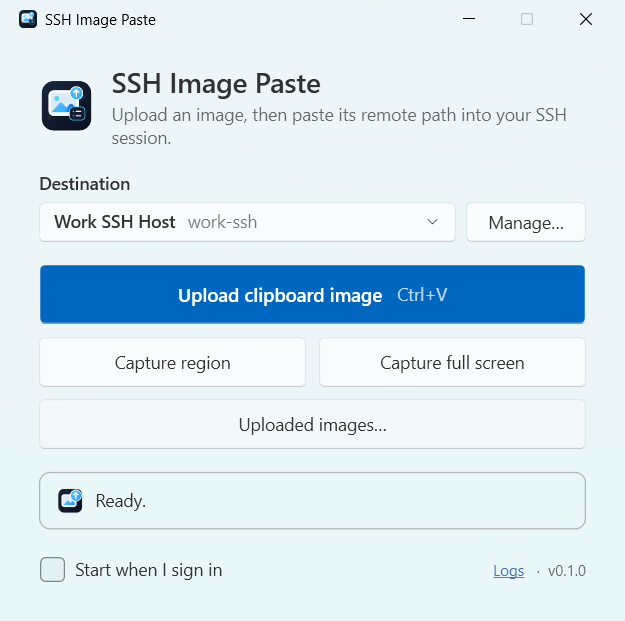
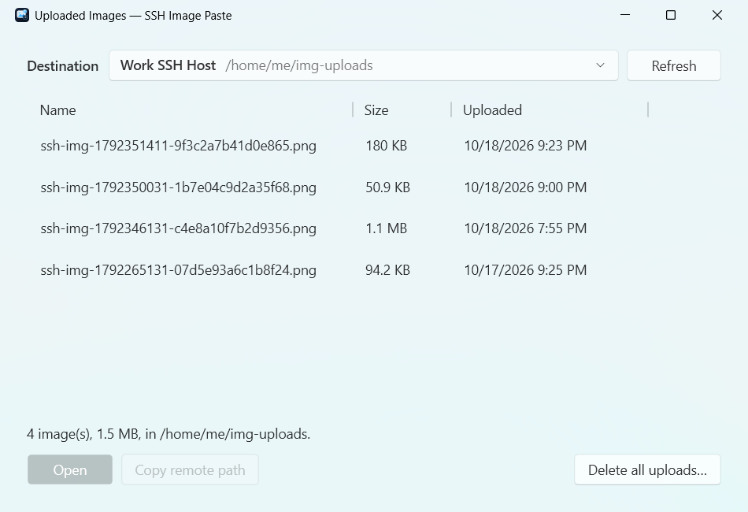
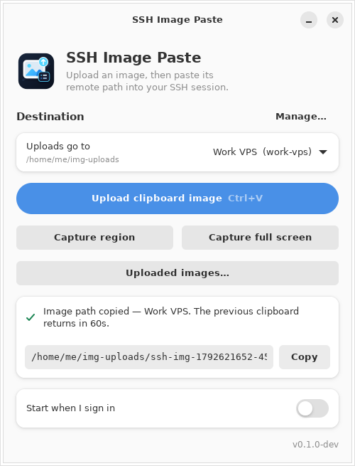
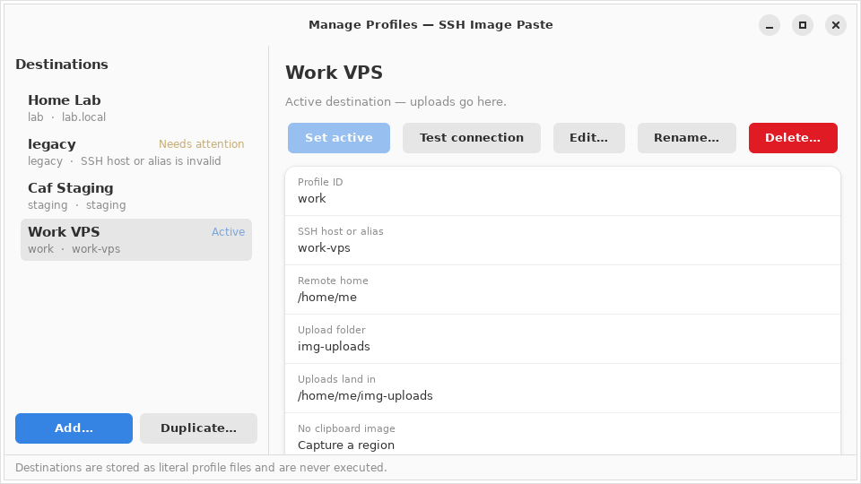

<p align="center">
  
</p>
<h1 align="center">SSH Image Paste</h1>
<p align="center">Send a clipboard image or screenshot from macOS, Windows, or Linux to any SSH host, then paste the remote path into your terminal.</p>
<p align="center">
  <a href="https://github.com/SerenityTn/ssh-img-paste/actions/workflows/ci.yml"></a>
  <a href="https://github.com/SerenityTn/ssh-img-paste/actions/workflows/windows-desktop.yml"></a>
  <a href="https://github.com/SerenityTn/ssh-img-paste/releases/latest"></a>
  <a href="#requirements"></a>
  <a href="docs/WINDOWS.md"></a>
  <a href="docs/LINUX.md"></a>
  <a href="LICENSE"></a>
</p>

SSH Image Paste turns an image on your computer into a remote file path that terminal tools can consume. It ships as a native macOS menu-bar app with a Bash CLI, and as Windows and Linux tray apps on a shared Rust CLI. No clipboard watcher, cloud account, daemon on the server, or proprietary protocol is required. Transfers use your existing OpenSSH setup.

| Platform | App | Status | Guide |
| --- | --- | --- | --- |
| macOS 13+ | AppKit menu-bar app and Bash CLI | Stable, Homebrew and source installs | This page |
| Windows 10 1809+ and 11 | WPF tray app and Rust CLI | New, per-user installer or portable zip | [Windows guide](docs/WINDOWS.md) |
| Linux (Wayland and X11) | GTK 4 / libadwaita tray app and Rust CLI | New, release archive or source build | [Linux guide](docs/LINUX.md) |

<table>
  <tr>
    <td width="50%"><br><sub>macOS profile manager</sub></td>
    <td width="50%"><br><sub>Windows profile manager</sub></td>
  </tr>
  <tr>
    <td><br><sub>Windows main window</sub></td>
    <td><br><sub>Windows uploaded images</sub></td>
  </tr>
  <tr>
    <td><br><sub>Linux main window</sub></td>
    <td><br><sub>Linux profile manager</sub></td>
  </tr>
</table>

## How it works

1. Click the menu-bar icon on macOS, or the tray icon on Windows and Linux.
2. If the clipboard holds an image, it is uploaded. Otherwise you drag to capture a screen region.
3. The PNG goes to your SSH host over SCP, and its remote path is copied to your clipboard.
4. Paste the path into your SSH session. Your previous clipboard comes back after 60 seconds.

Text paste crosses an SSH session; image paste does not. Terminal agents and CLI tools can attach a file when you paste its path, so this closes the gap.

## Features

All three editions share these features. The rest of this page covers macOS; the [Windows guide](docs/WINDOWS.md) and the [Linux guide](docs/LINUX.md) cover those tray apps, their installation, and their file locations.

- Native AppKit menu-bar app for macOS 13 and newer, a WPF tray app for Windows 10 1809+ and Windows 11, and a GTK 4 / libadwaita tray app for Linux on Wayland and X11.
- Clipboard image upload plus explicit region and full-screen capture.
- Multiple named SSH profiles with persistent active-destination selection.
- Native profile manager with add, edit, duplicate, rename, activate, connection test, and delete actions.
- Uploaded-image listing, download/open, and confirmed remote cleanup.
- Secure literal profile parser; profile files are never sourced or evaluated.
- Existing `~/.ssh/config`, keychain, and SSH-agent support.
- Apple Silicon and Intel source builds on macOS; x64 builds on Windows; x86_64 builds on Linux.
- Standalone CLI with stable machine-readable profile output.

## Quick start

### Windows

1. Download `SSHImagePaste-Setup-<version>-x64.exe` from [Releases](https://github.com/SerenityTn/ssh-img-paste/releases).
2. Run it. No administrator rights are needed. If SmartScreen warns, choose **More info**, then **Run anyway**; the installer is not code-signed yet.
3. In the window that opens, add a destination: your SSH host, then **Detect** for the remote home, then **Save**.
4. Click the tray icon to upload.

Your SSH host must accept `ssh -o BatchMode=yes your-host true` without a prompt. The [Windows guide](docs/WINDOWS.md) covers requirements, the portable zip, and troubleshooting.

### Linux

1. Install the clipboard and SSH tools: `sudo apt install wl-clipboard xclip openssh-client` (Ubuntu 24.04+, Debian 13+; Fedora 40+ has the same packages).
2. Download `ssh-img-paste-linux-<version>-x86_64.tar.gz` from [Releases](https://github.com/SerenityTn/ssh-img-paste/releases), extract it, and run `./install.sh`. It installs into `~/.local` without root.
3. Open **SSH Image Paste** from your applications menu and add a destination: your SSH host, then **Detect**, then **Save**.
4. Click the tray icon to upload, or bind `ssh-img-paste-linux --upload-clipboard` to a keyboard shortcut.

The tray icon needs a StatusNotifierItem host (KDE, XFCE, and most panels; the AppIndicator extension on GNOME). The [Linux guide](docs/LINUX.md) covers screenshots, shortcuts, source builds, and troubleshooting.

### Install with Homebrew (macOS)

```sh
brew install SerenityTn/tap/ssh-img-paste
brew services start ssh-img-paste
```

Secondary-click the new menu-bar icon, open **Destination**, choose **Manage Profiles**, and add a destination. Configure the remote login first if needed:

```sshconfig
Host work-ssh
  HostName 203.0.113.10
  User me
  IdentityFile ~/.ssh/work_ed25519
```

Then use these profile values:

```text
Display name: Work SSH Host
SSH host or alias: work-ssh
Remote home: /home/me
Upload folder: img-uploads
```

Create the remote folder once:

```sh
ssh work-ssh 'mkdir -p ~/img-uploads'
```

Left-click the menu-bar icon to upload. Secondary-click it to switch destinations, capture explicitly, load uploaded images, manage profiles, or clean the active destination.

### Install from source (macOS)

```sh
git clone https://github.com/SerenityTn/ssh-img-paste.git
cd ssh-img-paste
./install.sh
```

The source installer builds `~/Applications/SSHImagePaste.app`, links the CLI at `~/bin/ssh-img-paste`, creates a default named profile for fresh installations, and starts a user LaunchAgent.

## Menu behavior (macOS)

| Action | Result |
| --- | --- |
| Left-click | Upload the clipboard image; if none exists, use the configured screenshot fallback. |
| Secondary-click or Option-click | Open the destination and upload menu. |
| Destination | Persistently change the active profile or open the profile manager. |
| Capture Region | Request Screen Recording access, select a region, and upload it. |
| Capture Full Screen | Capture the main display and upload it. |
| Uploaded Images | Load/refresh remote PNGs, then download one and open it in Preview. |
| Clean All Uploads | Confirm and delete PNG uploads from the selected profile's configured remote directory. |

The status icon changes while work is in progress and briefly shows success or failure. The app acts only when you invoke it; it does not monitor the clipboard or register a global hotkey.

## CLI examples

```sh
ssh-img-paste                       # upload to the active profile
ssh-img-paste --profile work upload # one-command profile override
ssh-img-paste region                # capture a region and upload
ssh-img-paste list                  # SIZE<TAB>NAME, newest first
ssh-img-paste fetch NAME.png        # download and print the local path

ssh-img-paste profiles
ssh-img-paste profile current
ssh-img-paste profile use work
ssh-img-paste profile inspect work
ssh-img-paste profile test work
```

See [the complete CLI reference](docs/CLI.md) for profile creation, updates, rename, deletion, output contracts, and exit behavior.

## Configuration (macOS)

Named profiles live under the following paths, on Linux too. Windows keeps them in `%LOCALAPPDATA%\SSH Image Paste`; see the [Windows guide](docs/WINDOWS.md#files-and-settings).

```text
~/.config/ssh-img-paste/profiles/<id>.env
~/.config/ssh-img-paste/active-profile
```

The app stores a label, SSH host or alias, absolute remote home, relative upload folder, screenshot mode, and clipboard restore delay. Passwords, private keys, ports, and jump-host configuration are not app-managed profile fields.

Profile files are parsed as literal data. Dynamic supported values such as `${USER}`, command substitution, backticks, `source`, and functions are not executed. Existing manual files with literal supported fields remain usable but read-only in the GUI.

Read [Profile configuration](docs/CONFIGURATION.md) for the field reference, SSH aliases, parser contract, and permissions.

## Permissions and signing (macOS)

Region and full-screen capture require macOS Screen Recording permission. The app asks only when an explicit capture needs it:

**System Settings → Privacy & Security → Screen Recording → SSH Image Paste**

Clipboard-only uploads do not require Screen Recording access.

Current source and Homebrew builds are compiled locally and ad-hoc signed. A stable designated requirement keeps the app's Screen Recording identity consistent across rebuilds, but the build is not Apple-notarized. Review [SECURITY.md](SECURITY.md) for the trust model and private vulnerability-reporting channel.

## Requirements

These are the macOS requirements. For Windows, see the [Windows guide](docs/WINDOWS.md#requirements); for Linux, the [Linux guide](docs/LINUX.md#requirements).

- macOS 13 or newer, Apple Silicon or Intel.
- Xcode Command Line Tools for source builds.
- [`pngpaste`](https://github.com/jcsalterego/pngpaste) to read clipboard images.
- SSH key access to the destination host.

The Homebrew formula installs `pngpaste`. For a source build:

```sh
xcode-select --install
brew install pngpaste
```

## Development

```sh
brew install shellcheck
make check       # lint, isolated integration tests, Swift tests, app build/signature
make build       # build the app in ~/Applications
make icon        # regenerate AppIcon.icns from the SVG source
make screenshot  # regenerate the README screenshot with fixture data
```

Tests use temporary homes and mocked network, clipboard, screenshot, installer, and LaunchAgent commands. They do not contact a real SSH host.

The CLI is the authority for parsing, validation, profile persistence, and remote operations. The AppKit layer invokes it with argument arrays and does not write shell-backed configuration directly. Read [CONTRIBUTING.md](CONTRIBUTING.md) before changing those boundaries.

## Troubleshooting

### The app cannot connect

Run the same alias through OpenSSH, then use the read-only profile test:

```sh
ssh work-ssh true
ssh-img-paste profile test work
```

Keep ports, users, key paths, and jump hosts in `~/.ssh/config`.

### Upload succeeds but the expected folder is empty

Check that **Remote home** is the SSH account's real absolute home and that **Upload folder** is relative to it. All operations use exactly `SSH_REMOTE_HOME/SSH_REMOTE_DIR`.

### Screenshot capture is unavailable

Confirm Screen Recording permission for **SSH Image Paste**, then quit and reopen the app. Clipboard-image uploads can still work without that permission.

### Two menu-bar icons appear

An older Homebrew service or source LaunchAgent may still be running. Re-run the installation method you want to keep. The source installer removes known obsolete Homebrew launch paths before loading its current app.

## Upgrade and uninstall

Homebrew:

```sh
brew update
brew upgrade ssh-img-paste
brew services restart ssh-img-paste
```

Source checkout:

```sh
git pull --ff-only
./install.sh
```

Remove a source installation:

```sh
./uninstall.sh
```

Uninstalling preserves profile configuration. Delete it manually only if you no longer need it.

## Community

- [Contributing guide](CONTRIBUTING.md)
- [Security policy](SECURITY.md)
- [Code of conduct](CODE_OF_CONDUCT.md)
- [Changelog](CHANGELOG.md)
- [MIT License](LICENSE)