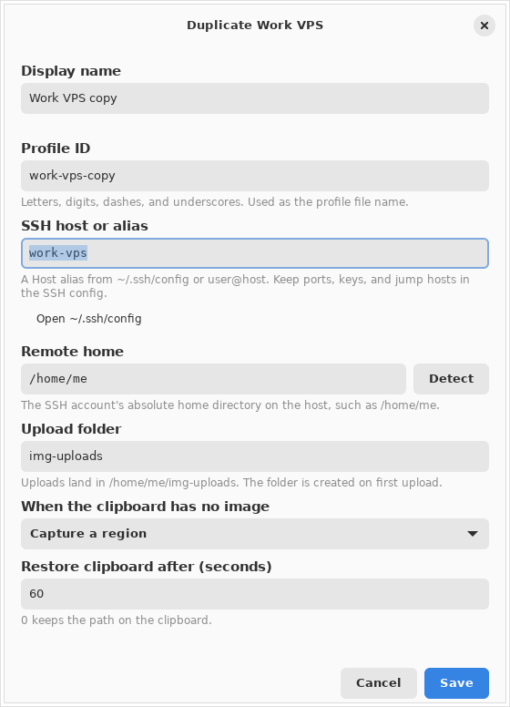
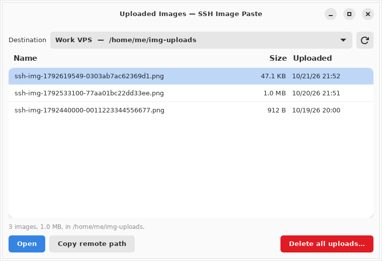

# Linux edition

The Linux edition is a GTK 4 / libadwaita app with a tray icon. Like the Windows edition, it is a thin shell over the Rust CLI (`ssh-img-paste`), which owns profiles and every SSH step. It has the same features as the Windows tray app, adapted to Linux desktops.


## What it does

- **Upload Clipboard Image**: uploads the clipboard image and replaces the clipboard with its remote path. If the clipboard holds no image, the app takes a screenshot instead, using the destination's "When the clipboard has no image" setting.
  - Trigger it with a click on the tray icon, the menu item, the window button, Ctrl+V in the window, or `ssh-img-paste-linux --upload-clipboard`.
  - PNG is used directly. Other image types (JPEG, BMP, …) are converted to PNG first.
- **Capture Region / Capture Full Screen**: takes a screenshot, uploads it, and copies the path.
  - Regions are picked with your desktop's own screenshot tool, much as the macOS edition uses the system picker.
  - The app's windows hide while the screenshot is taken.
- **Destination** submenu in the tray, and a picker in the window, to choose where uploads go.
- **Manage Profiles…**: add, duplicate, edit, rename, delete, activate, and test destinations. Detect fills the remote home over SSH.
- **Uploaded Images…**: lists a destination's uploads. You can open one in your image viewer, copy its remote path, or delete them all.
- **Clipboard restore**: after the destination's delay (60 seconds by default), the earlier clipboard returns, but only if the path is still on it. If anything else was copied in the meantime, it is left alone.
- **Notifications** report each result. Clicking one opens the main window. They are skipped while the main window has focus.
- **Start when I sign in** adds an XDG autostart entry. The app then starts with `--background`, so only the tray icon appears.

## Requirements

- A Wayland or X11 session.
- **Clipboard:** `wl-clipboard` on Wayland, `xclip` on X11.
- **Screenshots:** the XDG desktop portal (`xdg-desktop-portal` plus your desktop's backend; GNOME and KDE ship it). Without a portal, the app uses `grim` and `slurp` on wlroots compositors such as Sway and Hyprland, or `maim` or `scrot` on X11.
- **OpenSSH client**, with key-based access to the destination through `ssh-agent` or `IdentityFile`. Passphrase prompts are not supported. Make sure `ssh -o BatchMode=yes your-host true` succeeds.
- **Tray icon:** a StatusNotifierItem host. KDE Plasma and most panels have one; on GNOME, install the AppIndicator extension. Without a tray host, the window stays open as the app's home, and closing it quits.

On Debian and Ubuntu:

```bash
sudo apt install wl-clipboard xclip openssh-client xdg-desktop-portal
```

## Install

The release archive runs on x86_64 distributions with GTK 4.6+ and libadwaita 1.5+: Ubuntu 24.04 or newer, Debian 13, Fedora 40 or newer.

1. Download `ssh-img-paste-linux-<version>-x86_64.tar.gz` and `SHA256SUMS.txt` from [Releases](https://github.com/SerenityTn/ssh-img-paste/releases).
2. Verify and extract the archive:

   ```bash
   sha256sum --check --ignore-missing SHA256SUMS.txt
   tar -xzf ssh-img-paste-linux-*-x86_64.tar.gz
   ```

3. Install the app for your user, then open **SSH Image Paste** from the applications menu:

   ```bash
   cd ssh-img-paste-linux-*-x86_64
   ./install.sh                             # into ~/.local
   sudo ./install.sh --prefix /usr/local    # or for every user
   ```

`install.sh` puts the app and its CLI side by side in `PREFIX/lib/ssh-img-paste`, links `ssh-img-paste-linux` and `ssh-img-paste` into `PREFIX/bin`, and adds a menu entry and the icon. It never overwrites a different program that is already in `PREFIX/bin`. It names any clipboard or SSH package that is still missing.

To remove it, run `./install.sh --uninstall`, adding `--prefix` if you used one. It removes the app, the links, the menu entry, and the sign-in entry. Your destinations in `~/.config/ssh-img-paste` are kept.

## Build and run from source

```bash
sudo apt install libgtk-4-dev libadwaita-1-dev
cargo build --manifest-path rust/ssh-img-paste-cli/Cargo.toml --release
cargo build --manifest-path rust/ssh-img-paste-linux/Cargo.toml --release
cp rust/ssh-img-paste-cli/target/release/ssh-img-paste \
   rust/ssh-img-paste-linux/target/release/ssh-img-paste-linux ~/.local/bin/
ssh-img-paste-linux
```

The app finds the CLI in this order:

1. `SSH_IMG_PASTE_CLI`, if it is an absolute path.
2. Next to the app's own executable.
3. On `PATH`.

`SSH_IMG_PASTE_CONFIG_ROOT` overrides the settings root, as on Windows.

## Add a destination

The first start opens **Manage Profiles** with the editor ready.



1. Enter a display name. The profile ID is suggested from it.
2. Enter the SSH host: a `Host` alias from `~/.ssh/config`, or `user@host`. Keep ports, keys, and jump hosts in the SSH config.
3. Choose **Detect** to fill the remote home from the host, or type it.
4. Keep `img-uploads` as the upload folder, or choose another folder relative to the remote home.
5. Choose **Save**. The first destination becomes the active one.

Every field is checked as you type, with the same rules as the CLI. The CLI checks everything again when it saves.


Profile files you wrote by hand are shown as read-only. Files the app cannot use are marked **Needs attention**, with the reason.



## Keyboard shortcuts

Wayland does not let apps grab global shortcuts, so bind them in your desktop's settings. On GNOME, open **Settings → Keyboard → Custom Shortcuts**; on KDE, open **System Settings → Shortcuts**. Bind any of these commands:

| Command | Effect |
|---|---|
| `ssh-img-paste-linux --upload-clipboard` | Upload the clipboard image (or take a screenshot when it holds none) |
| `ssh-img-paste-linux --capture-region` | Capture a region and upload it |
| `ssh-img-paste-linux --capture-full` | Capture the full screen and upload it |

Each command hands the request to the running app over D-Bus, or starts the app in the tray if it is not running.

Other options:

| Option | Effect |
|---|---|
| *(none)* | Open the app, or show the running instance |
| `--background` | Start in the tray without opening the window |
| `--quit` | Quit the running instance |
| `--help` | Show usage |

In the tray, a click uploads and a middle click opens the window.

## Files and privacy

| What | Where |
|---|---|
| Profiles | `~/.config/ssh-img-paste/` (`$XDG_CONFIG_HOME`), written by the CLI |
| Images being uploaded | `$XDG_RUNTIME_DIR/ssh-img-paste/staging`, or `~/.cache/ssh-img-paste/staging` if that is not set |
| Autostart entry | `~/.config/autostart/io.github.serenitytn.SSHImagePaste.desktop` |

- Images being uploaded are private files (`0600`) in a private folder (`0700`). Each one is deleted as soon as the CLI has made its own copy, and leftovers from a crash are removed at the next start.
- Clipboard tools and capture tools always run with argument lists, never through a shell.
- Some desktop portals keep their own copy of each screenshot (GNOME, for example, may save one under Pictures).

## Troubleshooting

| Message or symptom | Fix |
|---|---|
| "Clipboard support needs wl-clipboard" / "needs xclip" | Install the package it names. |
| "No screenshot service is available" | Install `xdg-desktop-portal` and your desktop's backend, or `grim` and `slurp` (wlroots), or `maim` (X11). |
| "The SSH key was rejected" | Run `ssh-add`, or set `IdentityFile` for the host in `~/.ssh/config`. |
| "The host key is not trusted yet" | Run `ssh <host>` once in a terminal and accept the key. |
| No tray icon on GNOME | Install the AppIndicator extension. The window works without it. |

## Testing

```bash
# Unit tests, plus the X11 clipboard end-to-end test when a display is present.
cargo build --manifest-path rust/ssh-img-paste-cli/Cargo.toml --bin ssh-img-paste --example fake_openssh
SSH_IMG_PASTE_E2E_CLI="$PWD/rust/ssh-img-paste-cli/target/debug/ssh-img-paste" \
SSH_IMG_PASTE_E2E_FAKE_OPENSSH="$PWD/rust/ssh-img-paste-cli/target/debug/examples/fake_openssh" \
  xvfb-run -a cargo test --manifest-path rust/ssh-img-paste-linux/Cargo.toml

# Desktop end-to-end, against the running app.
cargo build --manifest-path rust/ssh-img-paste-linux/Cargo.toml
dbus-run-session -- xvfb-run -a tests/test-linux-desktop.sh
```

The desktop script uses a fake OpenSSH and `tests/fake_sni_watcher.py` in place of a desktop panel. It checks the tray menu, a tray-click upload, the clipboard restore, a full-screen capture, and `--quit`.

`linux/package.sh` builds the release archive and `SHA256SUMS.txt` in `dist/`. CI builds one on every run and attaches it to the run.

Version 0.1.0 has been tested on XFCE (X11), with its tray. GNOME and KDE on Wayland, where screenshots go through the desktop portal, have not been tested yet; reports are welcome.
