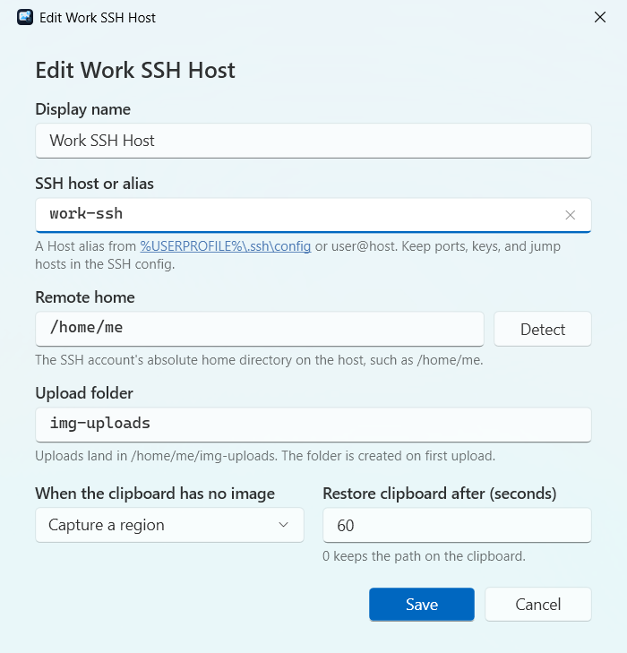

# SSH Image Paste for Windows

The Windows edition is a notification-area (tray) app for Windows 10 version 1809 or newer and Windows 11. It uses the OpenSSH client that ships with Windows and your existing `%USERPROFILE%\.ssh\config`. It never stores passwords or keys.


The desktop app is a thin shell. A bundled Rust command-line tool, `ssh-img-paste.exe`, does all validation, profile storage, and OpenSSH calls, as described in the [cross-platform architecture](CROSS_PLATFORM_ARCHITECTURE.md).

## Requirements

- Windows 10 version 1809 or newer, or Windows 11, on x64.
- The **OpenSSH Client** optional feature. It is installed by default on current Windows. If it is missing, add it in **Settings > System > Optional features**.
- Key-based SSH access that works without a prompt. Check it in a terminal:

  ```powershell
  ssh -o BatchMode=yes your-host true
  ```

  This must succeed without asking for a password or passphrase. If your key has a passphrase, load it into the Windows ssh-agent:

  ```powershell
  # Once, from an administrator PowerShell:
  Set-Service ssh-agent -StartupType Automatic; Start-Service ssh-agent
  # Then, as yourself:
  ssh-add $env:USERPROFILE\.ssh\id_ed25519
  ```

- On the host: a POSIX shell and GNU `find` for listing uploads, which any common Linux distribution provides.

## Install from source

Signed installers are not published yet. To build and install for your user account, you need the [.NET 10 SDK](https://dotnet.microsoft.com/download) and [Rust](https://rustup.rs) 1.92 or newer.

```powershell
git clone https://github.com/SerenityTn/ssh-img-paste.git
cd ssh-img-paste
cargo build --release --locked --manifest-path rust/ssh-img-paste-cli/Cargo.toml
dotnet publish windows/SSHImagePaste.Windows -c Release -r win-x64 --self-contained -o "$env:LOCALAPPDATA\Programs\SSH Image Paste"
& "$env:LOCALAPPDATA\Programs\SSH Image Paste\SSHImagePaste.exe"
```

The publish step copies the CLI next to the app. To start the app at sign-in, select **Start when I sign in** in the main window.

## First run

1. The app opens **Manage Profiles** with the **Add destination** form.
2. Enter a display name and an SSH host. The host is an alias from your SSH config, or `user@host`.
3. Click **Detect** to read the remote home directory from the host, or type it yourself, such as `/home/me`.
4. Keep or change the upload folder. It is relative to the remote home and is created on the first upload.
5. Save. The first destination becomes the active one.



Keep ports, users, keys, and jump hosts in your SSH config, for example:

```sshconfig
Host work-ssh
  HostName 203.0.113.10
  User me
  IdentityFile ~/.ssh/work_ed25519
```

## Everyday use

| Action | Result |
| --- | --- |
| **Upload clipboard image**, or Ctrl+V in the main window | Uploads the clipboard image. With no image on the clipboard, it falls back to the destination's screenshot mode. |
| **Capture region** | Freezes the screen, lets you drag a rectangle across any monitor, and uploads it. Esc or right-click cancels. |
| **Capture full screen** | Captures the monitor under the mouse pointer and uploads it. |
| **Uploaded images…** | Lists uploads newest first. Open downloads an image and opens it, Copy remote path copies its path, and Delete all uploads removes every PNG in the upload folder after you confirm. |
| **Manage Profiles…** | Add, edit, duplicate, rename, activate, test, or delete destinations. |
| Tray icon click | Uploads, like **Upload clipboard image**: the clipboard image, or a screen capture when there is none. |
| Tray icon double-click | Opens the main window. |
| Tray icon right-click | Opens the menu with the same actions and a **Destination** switcher. |

After an upload, the remote path is on the clipboard, ready to paste into your SSH session. The path is kept out of Windows clipboard history and cloud sync. After the destination's restore delay, 60 seconds by default, the earlier clipboard content comes back, unless something else replaced the clipboard in the meantime.

The tray icon shows a badge while uploading and briefly shows success or failure. When the main window is not in focus, a notification shows the result.


## Files and settings

| What | Where |
| --- | --- |
| Destinations | `%LOCALAPPDATA%\SSH Image Paste\profiles\<id>.env` |
| Active destination | `%LOCALAPPDATA%\SSH Image Paste\active-profile` |
| Diagnostic log | `%LOCALAPPDATA%\SSH Image Paste\logs\app.log`, also reachable from the **Logs** link |
| Opened downloads | `%TEMP%\ssh-img-paste-downloads`, removed after a week |
| Start at sign-in | `HKCU\Software\Microsoft\Windows\CurrentVersion\Run`, value `SSH Image Paste` |

Profile files use the same literal format as the macOS edition and are never executed. Files written by hand with shell syntax such as `$USER` show as needing attention, and the rest of your destinations keep working.

Two environment variables exist for advanced setups and testing:

- `SSH_IMG_PASTE_OPENSSH_DIR` points to a folder containing a different `ssh.exe` and `scp.exe`.
- `SSH_IMG_PASTE_CONFIG_ROOT` points to a different settings folder. It must be an absolute path.

## Command line

The bundled `ssh-img-paste.exe` prints one JSON document per command and is safe to script:

```powershell
$cli = "$env:LOCALAPPDATA\Programs\SSH Image Paste\ssh-img-paste.exe"
& $cli profiles list --detailed
& $cli profiles test work
& $cli upload-file --source C:\path\shot.png --profile work --confirm-profile work
& $cli uploads list --profile work
& $cli uploads clean --profile work --confirm-profile work
```

Run it without arguments to see every command.

## Troubleshooting

The app turns common OpenSSH errors into a short explanation. These are the usual causes:

- **"The host key is not trusted yet."** Run `ssh your-host` once in a terminal and accept the key.
- **"The SSH key was rejected."** Load your key into the ssh-agent, or set `IdentityFile` in your SSH config.
- **"Bad owner or permissions" in a terminal.** Windows OpenSSH refuses config and key files that other accounts can write to. Restrict the file to your account, SYSTEM, and Administrators:

  ```powershell
  icacls $env:USERPROFILE\.ssh\config /inheritance:r /grant:r "${env:USERDOMAIN}\${env:USERNAME}:F" "NT AUTHORITY\SYSTEM:F" "BUILTIN\Administrators:F"
  ```

- **Uploads land in the wrong folder.** Use **Test connection** in Manage Profiles. It reports whether the configured remote home matches the host's real home.
- **Listing uploads fails.** The host needs GNU `find`.

For anything else, open the **Logs** link in the main window and include `app.log` when you report an issue.

## Development

```powershell
cargo build --release --locked --manifest-path rust/ssh-img-paste-cli/Cargo.toml
cargo build --examples --manifest-path rust/ssh-img-paste-cli/Cargo.toml
$env:SSH_IMG_PASTE_FAKE_OPENSSH = "$PWD\rust\ssh-img-paste-cli\target\debug\examples\fake_openssh.exe"
dotnet run --project windows/SSHImagePaste.Windows.ContractTests -c Release
```

The contract tests drive the real CLI through the app's service layer, using a fake OpenSSH, and keep their files out of your real settings folder. To regenerate the icons, run `dotnet run --project windows/tools/AssetGenerator -- windows`.
